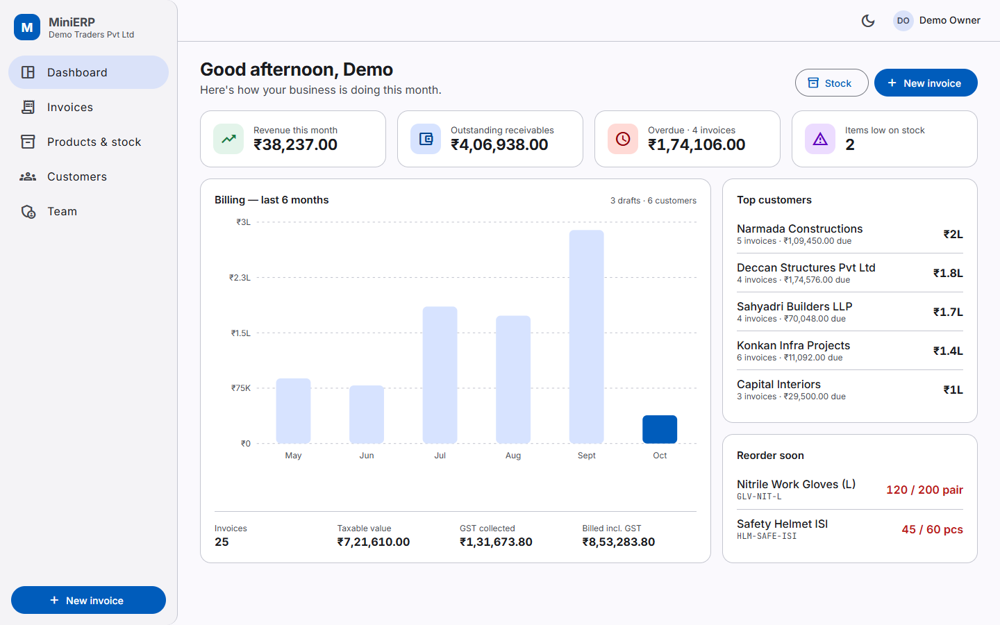
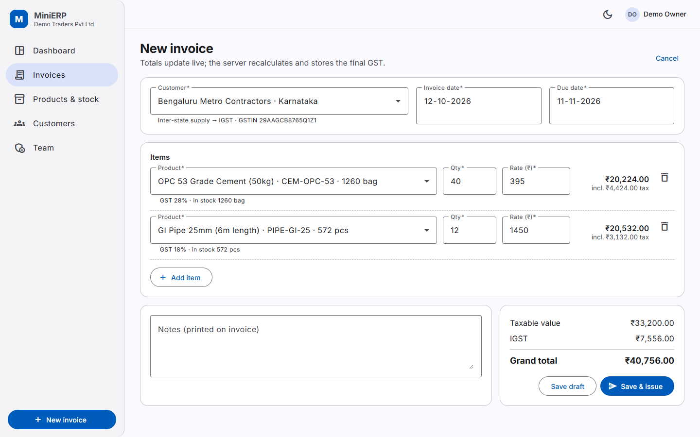
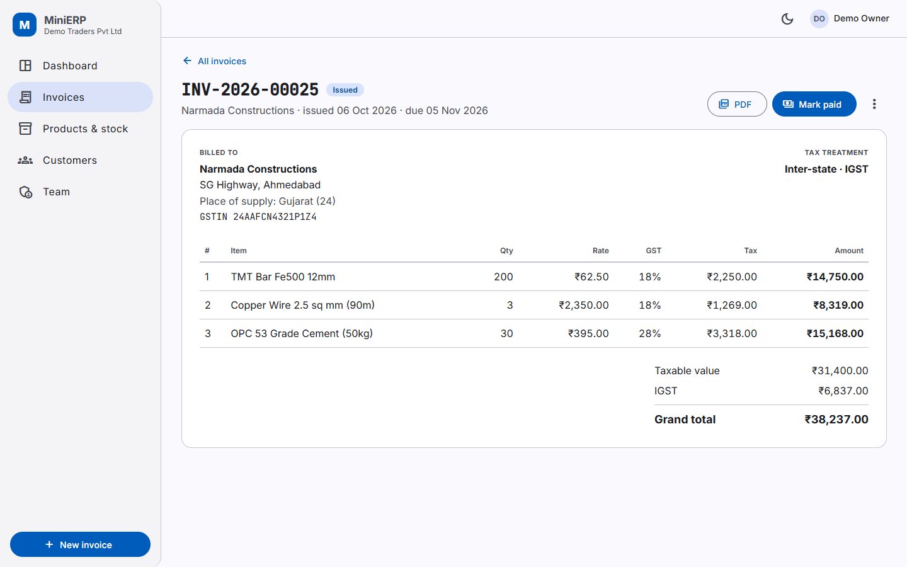
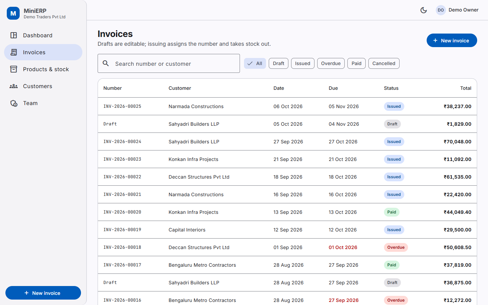
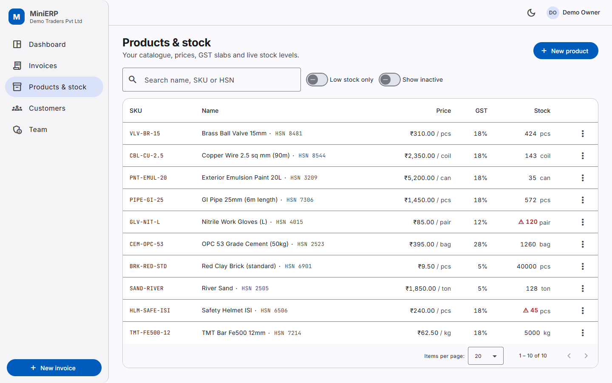
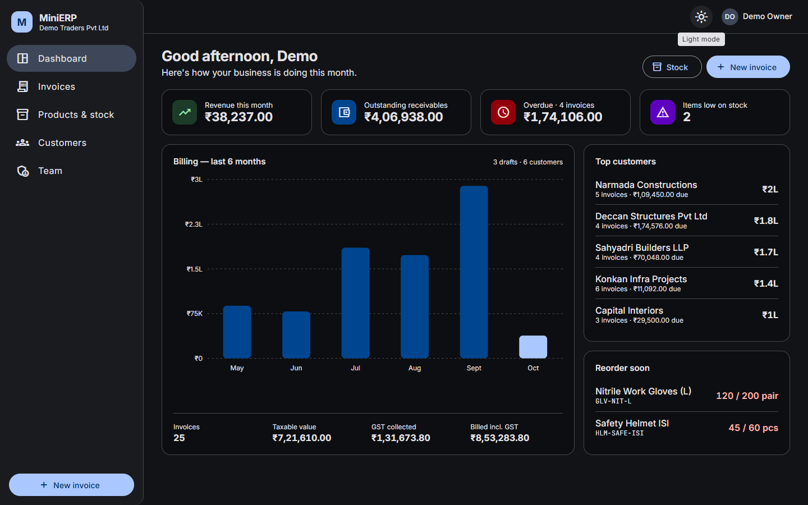
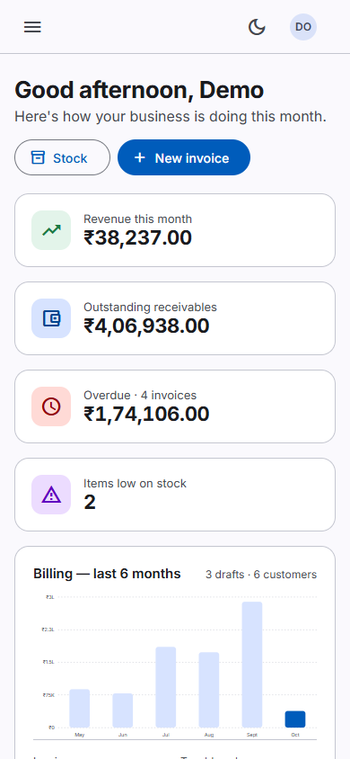
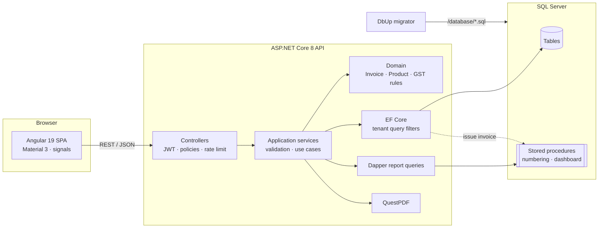

<h1 align="center">MiniERP — multi-tenant inventory & GST invoicing</h1>

<p align="center">
  A production-style SaaS ERP slice for Indian small businesses: every company gets an isolated workspace to manage stock,
  bill customers with correct <b>CGST / SGST / IGST</b>, issue gap-free numbered invoices as PDF and track receivables.
</p>

<p align="center">
  <a href="https://github.com/KumarNitish007/mini-erp-saas/actions/workflows/ci.yml"></a>
  
  
  
  
</p>



## Why this project

Most ERP code I've written professionally is proprietary, so this repository shows the same kind of work in the open,
built from scratch: a clean-architecture .NET 8 API, a SQL Server schema with stored procedures, and a modern Angular 19 UI —
with the hard parts (tenant isolation, tax maths, concurrency, numbering) solved properly and covered by tests.

## Features

| Area | What it does |
|---|---|
| **Multi-tenancy** | Self-service company sign-up. Every row carries a `TenantId`; EF Core global query filters + a save-time guard make cross-tenant reads *and* writes impossible (verified by integration tests). |
| **GST invoicing** | Place of supply decides **CGST + SGST** (same state) or **IGST** (inter-state). Per-line rounding to paise, SGST absorbs the odd paisa so halves always reconcile. Amount in words in the Indian system (lakh / crore). |
| **Invoice lifecycle** | Draft → Issued → Paid, or Cancelled. Drafts are editable; issuing allocates a **gap-free number per tenant per year** (`INV-2026-00001`) inside the same transaction that deducts stock. |
| **Inventory** | Products with HSN code and GST slab, opening stock, purchases/adjustments, an append-only **stock ledger**, low-stock alerts. Row-version concurrency stops two sales overselling the same item. |
| **PDF** | A4 tax invoice rendered server-side with QuestPDF ([sample](docs/sample-invoice.pdf)). |
| **Dashboard** | Revenue this month, receivables, overdue, low stock, 6-month billing chart, top customers — served by **stored procedures via Dapper**. |
| **Security** | JWT auth, role-based policies (Owner / Admin / Staff), secure-by-default fallback policy, rate-limited auth endpoints, PBKDF2 password hashing, RFC 7807 problem details. **No secrets in the repo.** |
| **UX** | Angular Material 3, signals, live GST preview while editing, dark mode, responsive down to phone width. |

## Screenshots

| Invoice editor (live IGST preview) | Invoice detail |
|---|---|
|  |  |
| **Invoices** | **Products & stock** |
|  |  |
| **Dark mode** | **Mobile** |
|  |  |

## Architecture



```
src/backend
├── MiniErp.Domain           entities + business rules (no dependencies)
├── MiniErp.Application      use-case services, DTOs, FluentValidation, interfaces
├── MiniErp.Infrastructure   EF Core, Dapper, DbUp, JWT, QuestPDF, demo seeder
└── MiniErp.Api              controllers, auth, problem details, Swagger
src/frontend                 Angular 19 app (standalone components, signals)
database/                    SQL schema migrations + stored procedures (source of truth)
tests/                       xUnit unit tests + integration tests on real SQL Server
infra/                       Azure Bicep (App Service + serverless Azure SQL)
```

Key trade-offs are written up in **[docs/decisions.md](docs/decisions.md)**: why the schema lives in SQL scripts (DbUp) instead of EF migrations, EF for writes / Dapper for reads, how tenant isolation and invoice numbering work.

## Getting started

### Option A: Docker (one command)

```bash
cp .env.example .env        # set MSSQL_SA_PASSWORD and JWT_KEY
docker compose up --build
```

Open <http://localhost:8080>. The API and Swagger run on <http://localhost:5080/swagger>.

### Option B: Local development (Windows + LocalDB)

Prerequisites: .NET 8 SDK, Node 22, SQL Server LocalDB (ships with Visual Studio).

```bash
dotnet run --project src/backend/MiniErp.Api      # http://localhost:5080/swagger
```

```bash
cd src/frontend && npm install && npm start       # http://localhost:4200 (proxies /api)
```

In Development the API creates the `MiniErp` database on LocalDB, applies the scripts in `/database` and seeds a fictional
company. Sign in with **`demo@minierp.dev` / `Demo@12345`** (local demo data only), or register your own company.

To use any other SQL Server, set the connection string through an environment variable or user-secrets — never in a committed file:

```bash
dotnet user-secrets --project src/backend/MiniErp.Api set "ConnectionStrings:Default" "<your connection string>"
```

## Tests

```bash
dotnet test tests/MiniErp.UnitTests                 # domain, GST maths, validation, number formatting
dotnet test tests/MiniErp.IntegrationTests          # full API against a real SQL Server
cd src/frontend && npm run test:ci                  # Angular unit tests (headless Chrome)
```

Integration tests start a throwaway **SQL Server 2022 container** with Testcontainers (that's what CI does).
Without Docker, point them at any SQL Server you own and they'll create and drop a uniquely named database:

```bash
MINIERP_TEST_SQL="Server=(localdb)\MSSQLLocalDB;Trusted_Connection=True;TrustServerCertificate=True" dotnet test tests/MiniErp.IntegrationTests
```

They cover tenant isolation, sequential numbering, rollback of a failed issue (stock restored, no number burned),
CGST/SGST vs IGST, role permissions, PDF output and the dashboard stored procedures.

## API overview

| Method | Route | Notes |
|---|---|---|
| `POST` | `/api/auth/register` · `/api/auth/login` | anonymous, rate-limited |
| `GET` | `/api/dashboard?months=6` | KPIs, monthly sales, low stock, top customers |
| `GET/POST/PUT` | `/api/products` · `/api/products/{id}/stock` | catalogue + stock ledger |
| `GET/POST/PUT` | `/api/customers` | place of supply + GSTIN validation |
| `GET/POST/PUT/DELETE` | `/api/invoices` | drafts |
| `POST` | `/api/invoices/{id}/issue` · `/mark-paid` · `/cancel` | lifecycle (cancel = Owner/Admin) |
| `GET` | `/api/invoices/{id}/pdf` | tax invoice PDF |
| `GET/POST` | `/api/users` | team management (Owner/Admin) |

Full OpenAPI docs at `/swagger` when the API is running.

## Deploying to Azure

`infra/main.bicep` provisions a Linux App Service (B1) and a serverless Azure SQL database that auto-pauses when idle.
The manual **Deploy to Azure** workflow publishes the API with the Angular build in `wwwroot`, so one site serves both.
Secrets go in as secure parameters / GitHub secrets.

## Roadmap

- Payments against invoices (part-payments, receipts) and customer statements
- Purchase orders and supplier bills feeding stock-in
- E-invoice (IRN) JSON export and GSTR-1 summary
- Background reminders for overdue invoices (Hangfire)
- Refresh tokens + HttpOnly cookie sessions; Key Vault for secrets

## Author

**Nitish Kumar** — Senior .NET / Full Stack Developer (C#, Angular, SQL Server, ERP)
[Portfolio](https://kumarnitish007.github.io/portfolio-master/) · [LinkedIn](https://linkedin.com/in/nitishkumar043) · [GitHub](https://github.com/KumarNitish007)

All company names, GSTINs and people in the demo data are fictional.
